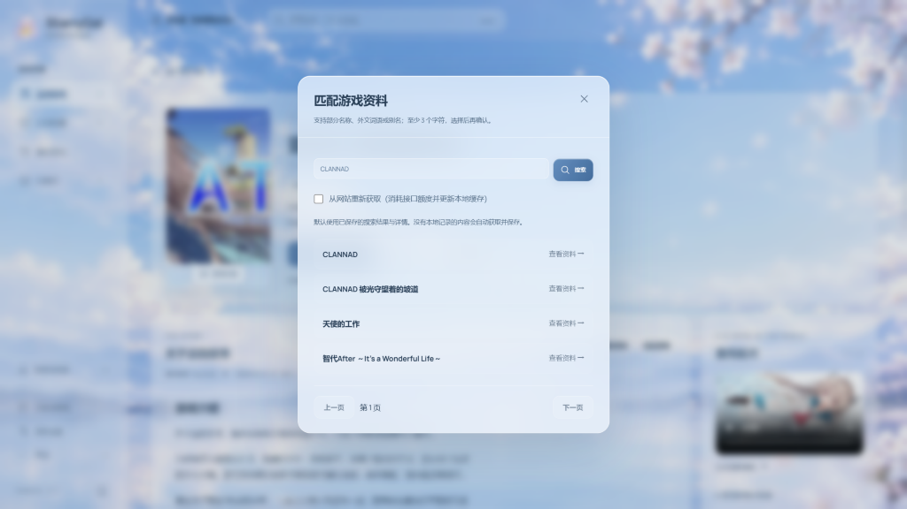
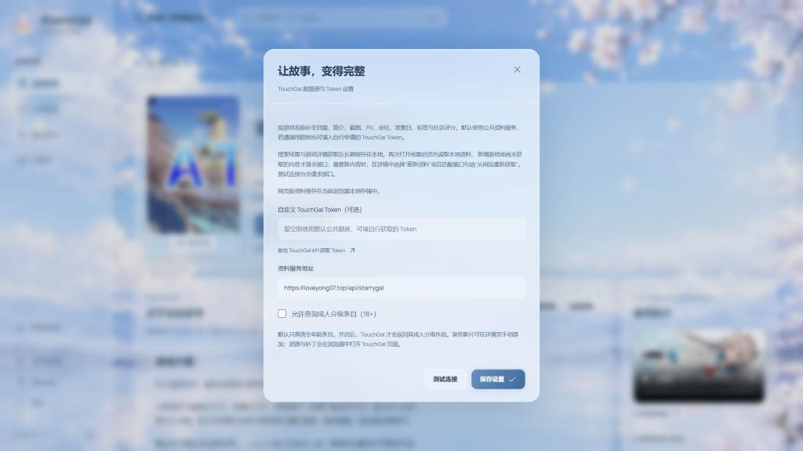
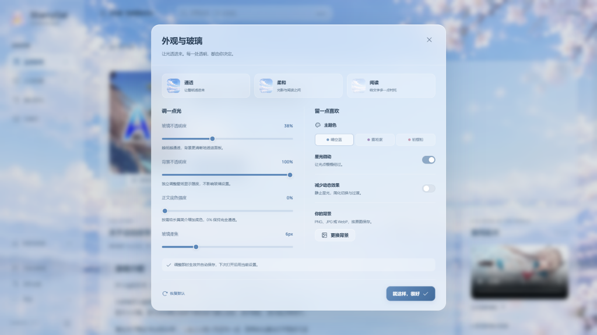

<p align="center">
  
</p>

<h1 align="center">StarryGal</h1>

<p align="center">把故事，收进日常。</p>

<p align="center">
  <a href="https://github.com/loveyong07/loveyong-starrygal/releases/latest">
    
  </a>
  
  <a href="./LICENSE">
    
  </a>
  
</p>

<p align="center">
  <a href="https://loveyong07.github.io/loveyong-starrygal/">桌面在线预览</a> ·
  <a href="https://github.com/loveyong07/loveyong-starrygal/releases/latest">下载最新版</a> ·
  <a href="#界面预览">界面预览</a> ·
  <a href="#核心功能">核心功能</a> ·
  <a href="#快速上手">快速上手</a> ·
  <a href="#使用提示与常见问题">常见问题</a> ·
  <a href="#开发运行">开发运行</a> ·
  <a href="#投喂">投喂</a> ·
  <a href="https://loveyong07.top/contact">反馈与联系</a>
</p>

<p align="center">
  
</p>

<p align="center">
  <sub>StarryGal v0.4.0 桌面端实机界面：统一游戏库、首屏继续故事焦点卡、纯粹海报流与晴昼/星夜通透玻璃外观</sub>
</p>

---

**StarryGal** 是一款免费开源的 **Windows 桌面端 Galgame 启动器与收藏管理工具**，基于 [morilove37/KoiPage](https://github.com/morilove37/KoiPage) 定制开发。它整合了**本地游戏与 Steam 游戏库管理**、**一键启动与游玩记录（含 LE 日区转区、Magpie 超分与 Steam 进程计时）**、**TouchGal 资料自动补全与本地持久缓存**、**本地存档快照备份**、**宣传影片 / 截图展示**，以及**游戏资源与补丁页面直达入口**（游戏本体与补丁下载在对应网站完成）。

- **应用名称**：安装后与窗口内统一显示为 **StarryGal**，源码仓库为 **loveyong-starrygal**；应用 Logo、桌面图标与网页图标统一采用原创人物抱星图案。
- **桌面优先体验**：界面专为桌面端设计（最小宽度 `1100px`），首次以 `1280×720` 居中窗口启动，并自动记住调整后的尺寸与最大化状态；顶部无原生标题栏，支持拖动、双击最大化与边缘缩放。
- **当前版本与许可**：当前正式版本为 **v0.4.0**（发布日期 **2026-11-26**），代码遵循 **GPL-3.0-only** 协议开源，完整许可见 [LICENSE](LICENSE)。

## 公告内容

> 本启动器完全开源免费，请使用时务必将游戏名称填入正确的名称，以便于自动导入

---

## 目录

- [桌面版与在线预览区别](#桌面版与在线预览区别)
- [界面预览](#界面预览)
- [核心功能](#核心功能)
- [快速上手](#快速上手)
- [窗口操作与快捷键](#窗口操作与快捷键)
- [数据存储、缓存与安全说明](#数据存储缓存与安全说明)
- [TouchGal API 与中转机制](#touchgal-api-与中转机制)
- [使用提示与常见问题](#使用提示与常见问题)
- [下载安装与覆盖升级](#下载安装与覆盖升级)
- [技术栈与源码结构](#技术栈与源码结构)
- [开发运行与测试](#开发运行)
- [致谢与许可](#致谢与许可)
- [投喂](#投喂)

---

## 桌面版与在线预览区别

StarryGal 同时提供 **Windows x64 桌面版** 与 **[GitHub Pages 桌面在线预览](https://loveyong07.github.io/loveyong-starrygal/)**（保留桌面布局，建议在 `1600×900` 或宽度 ≥ `1100px` 的桌面浏览器中访问）：

| 功能能力 | Windows 桌面版（推荐） | 网页在线预览 |
| --- | :---: | :---: |
| 统一游戏库、收藏、状态筛选、搜索、排序与视图切换 | ✅ 完整支持 | ✅ 完整支持 |
| TouchGal 关键词搜索、资料匹配、简介/截图/标签与 PV 展示 | ✅ 完整支持 | ✅ 完整支持 |
| 通透玻璃材质预设、透明度/柔焦滑块、主题色与自定义壁纸 | ✅ 完整支持 | ✅ 完整支持 |
| 自动发现本地常见目录与 Steam 游戏库 | ✅ 完整支持 | ❌ 需桌面环境（仅支持演示选择目录） |
| 直接启动 `.exe` / Steam 客户端、切换启动程序与游玩时长统计 | ✅ 完整支持 | ❌ 浏览器无法运行本地程序 |
| 系统托盘常驻与关闭前计时结算 | ✅ 完整支持 | ❌ 仅桌面端 |
| 本地数据与资料缓存存储位置 | 独立应用目录 SQLite + 本地 JSON 缓存 | 当前浏览器 `localStorage` / `IndexedDB` |

---

## 界面预览

### 1. 游戏详情页与宣传影片（PV / OP）

点击任意作品即可进入独立详情页，集中查看封面（点击可放大或更换自定义封面）、开发商、发行日期、游玩时长、当前启动 EXE、TouchGal 社区评分与完整简介，右侧内置宣传影片（PV / OP）播放器与链接管理。

<p align="center">
  
</p>

### 2. 游戏截图、故事标签与 TouchGal 直达入口

向下浏览详情页时，顶部会自动停靠紧凑启动栏（随时一键开始游戏）；游戏介绍下方紧接高清游戏截图（支持点击放大）与只读故事标签，页底提供当前作品的 TouchGal 游戏资源与补丁页面直达入口。

<p align="center">
  
</p>

### 3. TouchGal 关键词搜索与资料设置

<table>
  <tr>
    <td width="50%" align="center">
      
      <br />
      <sub><strong>关键词搜索与资料匹配</strong>：支持 3 个字符以上的部分名称、外文词语或别名检索，预览后再确认绑定，支持按需勾选“从网站重新获取”。</sub>
    </td>
    <td width="50%" align="center">
      
      <br />
      <sub><strong>数据源与 Token 设置</strong>：开箱即用默认中转服务，也支持填入自行申请的 TouchGal Token、切换 18+ 成人分级查询与管理本地资料缓存。</sub>
    </td>
  </tr>
</table>

### 4. 通透玻璃与个性化外观

内置「通透 / 柔和 / 阅读」三套材质预设与「晴昼 / 星夜 / 跟随系统」外观模式，可对玻璃不透明度、背景不透明度、正文底色强度、玻璃柔焦、主题色（晴空蓝 / 雾凇紫 / 初樱粉）、星光微动、减少动态效果及自定义本地壁纸（大图自动优化缩放）进行实时调节并自动保存。

<p align="center">
  
</p>

---

## 核心功能

### 统一游戏库与高效检索
- **一体化视图**：开始页与游戏库合并，左侧按「全部游戏 / 心动收藏 / 最近游玩 / 已通关」分类浏览；顶部支持按**作品名、原名/别名、会社、标签**实时搜索（兼容大小写、空格、全角字符与标点差异）。
- **首屏焦点横幅与纯粹海报流**：「最近打开」首部作品采用带氛围背板的焦点横幅展示，其余最近作品并列在侧；游戏库网格突出纯粹海报展示，悬停卡片时以零位移纯透明度淡入收藏与快捷启动浮标，无封面作品自动生成星云渐变首字占位。
- **灵活筛选与排版**：支持按游玩状态筛选、4 种排序方式（最近添加 / 最近打开 / 名称排序 / 游玩时长）、**小封面 / 大封面**两档直接点选以及**封面网格 / 列表视图**切换；排序、视图与封面大小在重启后保持不变（旧版中封面设置自动迁移为小封面）。
- **可读性与阅读体验**：网格标题最多显示 2 行并保持卡片按钮对齐，列表视图维持紧凑单行；工具栏自动换行适配较窄桌面窗口；从详情页返回游戏库时自动恢复原先的滚动位置。

### 游戏详情、状态流转与媒体展示
- **沉浸式独立详情页**：每次进入自动回到顶部并叠加作品专属柔焦氛围背景，向下滚动时顶部悬浮紧凑启动栏；点击封面可放大预览，也可上传自定义封面（PNG / JPG / WebP）并随时一键恢复资料原图。
- **清晰的游玩状态**：从未打开的作品为「待开始」；进入详情页后自动记为「游玩中」；「已通关」由用户手动标记，后续再次打开不会覆盖通关状态。实际游玩时长由本地及 Steam 进程运行记录统计，并在详情页温和展示游玩足迹，界面保持简洁，不附加个人评分或长评模块。
- **截图、官网链接、标签映射与 PV / OP**：自动识别 TouchGal 公开简介中的小标题、官网链接（系统浏览器打开）、Markdown 游戏截图（支持灯箱放大与 `←`/`→` 键盘翻页）与视频标记，并对只读故事标签做中文映射与分类展示。直接视频地址支持按需内嵌播放（带加载提示与失败重试），Bilibili / YouTube / Vimeo 等页面链接通过浏览器打开；也可手动保存自定义 HTTPS 视频链接、清空以隐藏影片，或一键搜索官方 PV / OP。

### 自动发现、Steam 识别与手动导入
- **首次自动发现**：桌面版首次确认公告后，自动检索各磁盘根目录常见游戏文件夹（`Games`、`Game`、`Galgame`、`Galgames`、`VisualNovels`、`游戏`、`单机游戏`），以及注册表与 Steam 库位置，自动过滤补丁、备份、汉化辅助文件、存档与安装/卸载程序。
- **Steam 游戏库识别**：自动读取本机 Steam 安装路径、`libraryfolders.vdf` 与已安装 `appmanifest_*.acf`；检测到常见视觉小说引擎特征（如 Ren'Py、BGI、ADVHD、SiglusEngine、RealLive、ONScripter、`.xp3`/`.rpa`/`.nsa`）的作品默认勾选，其他 Steam 游戏可自由勾选。
- **先核对、再导入**：所有扫描候选均在确认窗口中展示，可修改名称、勾选/取消条目或中途取消扫描；后续可随时通过「导入游戏 → 扫描文件夹」补充其他目录。
- **灵活手动添加**：支持点击选择或直接将 `.exe` 拖入窗口，支持提前按 ≥3 个字符搜索并关联 TouchGal 条目、填写可选启动参数；TouchGal 未收录的作品也可直接填写名称与 EXE 添加并正常启动。

### TouchGal 资料补全与本地持久缓存
- **自动 + 批量 + 手动匹配**：扫描导入后自动为新增作品匹配明确条目；也可点击游戏库右上角「补全资料」批量处理尚未匹配的作品（支持随时停止），或进入详情页点击「匹配资料 / 更新资料」手动搜索并预览后确认。
- **非破坏性更新**：默认仅补全空白字段；需要覆盖旧的接口资料时，可在确认前手动勾选替换选项，且始终保留自定义封面与手动设置的 PV 链接。
- **本地持久缓存**：搜索结果（包括未找到结果的查询）与作品详情首次获取后长期保存在本地，重启、重复打开与预览均优先命中本地缓存，相同并发请求自动合并，大幅节省 API 额度。只有在点击详情页「更新资料」或匹配窗口勾选「从网站重新获取」时才主动向网站刷新。
- **分级与自定义 Token**：默认仅查询全年龄数据，需在「资料设置」中手动开启「允许查询成人分级条目（18+）」后才返回 18+ 作品；支持填入自己的 TouchGal Token、修改中转地址及一键打开本地资料文件夹。

### 资源与补丁入口
- 左下角「探索与资源」提供 **[TouchGal](https://www.touchgal.ink/)**、**[InariGAL](https://inarigal.com/)** 与 **[Moyu Moe](https://www.moyu.moe/)** 三个快捷入口，点击后调用系统浏览器打开。
- 已匹配 TouchGal 的作品，详情页底部「前往 TouchGal」面板直接提供该作品的**游戏资源**与**补丁**页面直达链接，启动器本身不内置下载列表。

### 通透玻璃外观与系统集成
- **高度可调的玻璃材质**：支持「通透 / 柔和 / 阅读」三套预设、「晴昼 / 星夜 / 跟随系统」外观模式，以及 0–100% 玻璃不透明度、背景不透明度、正文底色强度、0–24px 玻璃柔焦、晴空蓝 / 雾凇紫 / 初樱粉主题色、星光微动、减少动态效果与自定义壁纸，所有调整即时生效并自动持久化。
- **启动辅助、本地存档备份与搬盘修复**：详情页点击「启动与辅助」可切换启动 EXE、填写启动参数、开启内置 **Locale Emulator 日区转区** 与 **Magpie 全屏超分** 滤镜模式（Steam 条目也可一键切回由 Steam 客户端启动）；点击「存档备份」可创建本地存档快照与自动备份；左下角「更多 → 路径检查与修复」支持搬盘后批量迁移路径。
- **公告、托盘与更新检查**：首次启动或公告内容更新时弹出说明（后续可在左下角「更多 → 公告」重温）；关闭窗口时支持「缩小至托盘」或「直接关闭」，有游戏运行时退出会提示结算当前游玩时长；启动后及定时检查本仓库 GitHub Releases 新版本，也可在「更多 → 检查更新」手动查询。

---

## 快速上手

1. **获取并启动**：前往 [GitHub Releases 最新版本](https://github.com/loveyong07/loveyong-starrygal/releases/latest) 下载 `StarryGal_0.4.0_windows_x64_setup.exe`（安装版，向导可自选目录）或 `StarryGal_0.4.0_windows_x64_portable.exe`（便携版，双击即用）。首次打开阅读公告后进入游戏库。
2. **导入你的游戏**：
   - **自动发现**：首次进入会自动扫描常见游戏目录与 Steam 库；在候选列表中核对名称、取消不需要的条目后确认导入。
   - **扫描指定文件夹**：如果游戏放在其他路径，点击顶部「导入游戏 → 扫描文件夹」选择目录即可。
   - **手动添加**：点击「添加游戏」，拖入或选择 `.exe`；可输入至少 3 个字符的部分名称/别名点击「搜索作品」预览并确认资料，未收录作品也可直接填写名称保存。
3. **补全与校正资料**：
   - 扫描导入后会自动补全新增游戏；如需补全存量未匹配作品，可点击游戏库右上角「补全资料」。
   - 若自动匹配未命中或有歧义，进入作品详情点击「匹配资料」按关键词手动选择；需要最新资料时点击「更新资料」或在匹配窗口勾选「从网站重新获取」。
   - 如需查询 18+ 分级作品或配置个人额度，请打开左下角「资料设置」。
4. **开始游玩、转区超分与存档备份**：
   - 在「最近打开」、游戏卡片或详情页点击「开始游戏」即可启动。
   - 如果自动扫描选到了错误的 `.exe`，或需要日区转区（LE）与 Magpie 全屏超分，进入作品详情点击「启动与辅助」调整并保存；点击「存档备份」即可为当前作品创建存档快照。
5. **定制专属外观**：点击左下角「外观与玻璃」，切换晴昼/星夜模式、喜欢的壁纸、主题色与通透度。

---

## 窗口操作与快捷键

| 操作 / 快捷键 | 效果说明 |
| --- | --- |
| `Ctrl + K` / `Ctrl + F` | 快速聚焦顶部搜索栏（在详情页按下会自动返回游戏库并聚焦搜索） |
| `Esc` | 清空搜索框并失焦，或关闭当前打开的弹窗与下拉菜单 |
| 拖动顶部空白栏 | 移动桌面窗口 |
| 双击顶部空白栏 | 最大化 / 还原窗口 |
| 拖动窗口边缘 | 自由缩放窗口宽高（最小 `1100×700`，自动记住尺寸与最大化状态） |
| 点击右上角关闭按钮 | 按用户偏好缩小至系统托盘或直接退出（运行中游戏退出前可选择先结算时长） |

---

## 数据存储、缓存与安全说明

| 数据类别 | 存储位置 / 行为说明 |
| --- | --- |
| **本地游戏本体** | 始终保留在原磁盘目录。在启动器中「移出游戏库」**仅删除管理记录，绝不删除游戏文件**；更新扫描规则也不会自动删除已有记录。 |
| **桌面版数据库与设置** | 保存在系统独立应用数据目录的 SQLite 数据库中（应用标识 `top.loveyong.opengal`），包含游戏库、游玩记录、自定义封面、外观设置与 Token；覆盖升级或替换便携版均完整保留。 |
| **TouchGal 本地资料缓存** | 桌面版保存在 `%APPDATA%\top.loveyong.opengal\touchgal-cache\v1\`，按查询分别生成 JSON 文件（记录查询地址、获取时间与公开资料，**不包含 Token**），可在「资料设置 → 打开本地资料文件夹」查看。 |
| **网页在线预览数据** | 保存在当前浏览器的 `localStorage` 与 `IndexedDB` 中，仅在本地浏览器生效。 |
| **Steam 启动与计时说明** | Steam 条目调用 Steam 客户端协议启动，桌面端并在后台校验该游戏安装目录下真实运行的程序进程以自动记录游玩时长；未检测到真实进程时绝不生成虚假记录。 |

---

## TouchGal API 与中转机制

本项目按照 [TouchGal 官方 API 文档](https://developer.touchgal.com/docs/api) 接入元数据服务：

- **默认公开中转**：默认服务地址为 `https://loveyong07.top/api/starrygal`，安装后无需配置开发者密钥即可使用；遇到公共额度限制时，可在「资料设置」中填写自行向 TouchGal 申请的自定义 Token，或更换为自建中转地址。
- **架构与核心模块**：
  - `src/features/galgame/touchgal.ts`：负责搜索、详情解析、字段归一化、严格标题匹配、取消过期请求与非破坏性资料合并。
  - `src-tauri/src/commands/touchgal.rs`：桌面端通过 Rust 发起 HTTP 请求，负责参数校验、超时控制与响应体大小限制（网页预览则使用无 Cookie 的公开请求）。
  - `src-tauri/src/commands/touchgal_cache.rs`：桌面端持久化缓存与并发请求去重合并；按服务地址、分级开关、关键词、分页与条目编号隔离缓存键，缓存不自动过期，仅在显式刷新或本地无有效记录时发起网络请求。
  - `api/starrygal.js`：部署于 Vercel 的服务端中转函数，共享密钥仅从服务端环境变量 `TOUCHGAL_API_TOKEN` 读取（**严禁使用 `VITE_` 前缀，绝不将真实密钥写入源码或安装包**）。
- **容错与限流策略**：
  - 中转端对成功响应启用 CDN 与实例缓存、合并并发查询，并提供实例级请求限流（上游共享密钥额度由 TouchGal 统一执行，可按需叠加 Vercel 防火墙规则）。
  - 完整处理未配置、认证失败、404、429、超时与服务不可用状态；**错误响应不会写入本地缓存，刷新失败时保留原有缓存**。旧版本已匹配的游戏继续使用 SQLite 中已有资料，查询失败不影响本地游戏管理与启动。
  - 桌面封面沿用现有图片缓存，不支持本地缓存的图片格式自动保留原图地址；测试连接属于主动探测请求，不走本地缓存。
  - 接口目前未提供独立 PV 字段，启动器会从公开简介中自动识别真实的视频与截图标记，缺失时保持留白、绝不编造媒体内容；默认请求全年龄数据，仅在用户显式开启后传入 `allowNsfw=true`。

---

## 使用提示与常见问题

1. **导入大量游戏时部分资料未能一次性补全？**
   由于 API 调用额度限制，可能无法一次性导入所有游戏资料。可稍后重试（具体恢复时间以接口额度为准），或在「资料设置」中配置自己申请的 Token `>_<`
2. **资料加载速度偏慢怎么办？**
   默认资料服务通过 Vercel 中转，网络连通性会影响加载速度；如果加载较慢，可以检查网络环境或稍后重试 `>_<`
3. **如何获取自己的 TouchGal Token？**
   前往 [TouchGal 官方 API 文档](https://developer.touchgal.com/docs/api) 申请后，填入启动器左下角「资料设置 → 自定义 TouchGal Token」并保存即可。
4. **搜不到某些作品或资料字段不完整？**
   - 游戏资料以 TouchGal 的收录内容为准，部分条目可能缺少字段或暂未收录；
   - 可尝试输入 **3 个字符以上的部分名称、外文原名或别名** 手动搜索确认；
   - 成人分级（18+）作品需先在「资料设置」中勾选「允许查询成人分级条目（18+）」；
   - 未收录的作品依然可以直接填写名称与 `.exe` 路径正常添加和启动。
5. **扫描到了错误的 `.exe` 或误导入了不需要的目录？**
   - 选错启动程序时，进入作品详情点击「更换启动程序」选择真正的游戏主程序即可；
   - 误导入的条目在详情页右下角点击「移出游戏库」，不会影响磁盘上的任何游戏文件。
6. **遇到启动、扫描、资料匹配问题或有功能建议？**
   项目仍在持续完善，欢迎通过 [反馈与联系](https://loveyong07.top/contact) 告诉我们具体情况 `(ฅ•.•ฅ)ﻌﻌﻌ♥️`

---

## 下载安装与覆盖升级

所有正式版与校验文件均发布于 [GitHub Releases](https://github.com/loveyong07/loveyong-starrygal/releases)，支持 **Windows 10 / 11 x64**：

| 分发形式 | 文件名示例（v0.4.0） | 安装与升级方式 |
| --- | --- | --- |
| **中文安装版** | `StarryGal_0.4.0_windows_x64_setup.exe` | 首次安装可点击「浏览」自选安装目录；升级时先正常关闭启动器，直接运行新版安装包即可沿用原安装目录覆盖升级，**无需先卸载**。 |
| **绿色便携版** | `StarryGal_0.4.0_windows_x64_portable.exe` | 下载后直接运行；升级时先正常关闭启动器，将新版 EXE 替换到原位置并保持原文件名即可。 |
| **校验文件** | `SHA256SUMS.txt` | 提供同版本所有可执行文件的 SHA-256 哈希，便于核对下载完整性。 |

> [!NOTE]
> - 安装版与便携版请分别使用对应类型文件升级；设置、Token、游戏库、封面、资料缓存和游玩记录保存在独立用户数据目录中，升级不会清除，游戏本体和个人文件也不会被安装器删除。
> - 当前版本未使用付费代码签名证书，亦暂未启用自动更新签名产物，点击应用内更新提示会前往 GitHub Releases 页面下载。

---

## 技术栈与源码结构

### 技术栈

| 层级 | 采用技术 |
| --- | --- |
| 桌面容器与本地能力 | Tauri 2、Rust、WebView2 |
| 前端界面与样式 | React 18、TypeScript、Vite、Tailwind CSS、自定义玻璃样式 |
| 本地持久化存储 | SQLite、`tauri-plugin-sql`、桌面 JSON 缓存 |
| 状态管理与路由 | Zustand、React Router |
| 图标与字体 | Phosphor Icons、Manrope、系统中文字体 |

### 源码结构

```text
loveyong-starrygal/
├── api/
│   └── starrygal.js                     # Vercel 服务端 TouchGal 中转与限流/缓存函数
├── public/
│   ├── brand/                           # StarryGal 品牌标志、图标与主界面预览图
│   └── wallpapers/                      # 默认天空樱湖壁纸
├── src/
│   ├── main.tsx                         # 前端入口（桌面端 / GitHub Pages 路由切换）
│   └── features/
│       ├── galgame/                     # StarryGal 核心界面：游戏库、详情、弹窗、外观与 TouchGal 适配器
│       ├── launch/                      # 游戏启动窗口与进程状态/游玩时长同步
│       └── window/                      # 无边框窗口控制栏与关闭/托盘行为对话框
├── src-tauri/
│   ├── src/
│   │   ├── scanner/discovery.rs         # 自动发现、Steam VDF/ACF 清单解析、候选去重与取消扫描
│   │   ├── commands/touchgal*.rs        # 桌面端 TouchGal HTTP 请求与本地持久缓存
│   │   └── launcher/                    # 复用的游戏启动、进程监控与 SQLite 能力
│   ├── resources/                       # 运行所需第三方组件、许可证与对应源码
│   └── windows/                         # 自定义 NSIS 中文安装器模板与 MIT 许可
├── tests/                               # Node 单元测试（游戏库、状态、公告、标题匹配、TouchGal 缓存/中转等）
├── scripts/                             # IPC 契约校验、发布一致性校验与升级验证脚本
└── .github/workflows/                   # ci.yml（构建测试）、pages.yml（预览部署）、release.yml（自动打包发布）
```

---

## 开发运行

### 环境要求
- **网页开发 / 构建**：Windows x64（或其他系统仅调试前端）、**Node.js 24**、项目声明版本的 **pnpm**（`packageManager: pnpm@12.11.2`）
- **运行或打包桌面版**：额外需要 **Rust stable**、**MSVC C++ 构建工具**、**Windows SDK** 与 **WebView2**

### 启动网页开发预览

```bash
git clone https://github.com/loveyong07/loveyong-starrygal.git
cd loveyong-starrygal
corepack enable
pnpm install --frozen-lockfile
pnpm dev
```

网页预览默认运行在 `http://127.0.0.1:1420`，建议使用 **1600×900（16:9）** 桌面画幅查看。网页预览可用于调试界面、游戏条目、收藏、标签、状态、TouchGal 检索与玻璃外观；本地磁盘扫描与运行 `.exe` 需要桌面环境。

### 运行桌面开发版

```bash
pnpm tauri dev
```

### 构建与完整性检查

```bash
pnpm build
pnpm build:pages
pnpm test
pnpm check:ipc
pnpm check:release
cargo test --manifest-path src-tauri/Cargo.toml --lib --bins --locked
```

### 维护者打包 Windows 安装包

```bash
pnpm tauri build --bundles nsis --ci
```

仓库内置的 `.github/workflows/release.yml` 会在 `package.json` 版本变更、推送 `v*` 标签或手动触发时，自动完成检查、Windows Rust 测试、NSIS 打包、自定义目录安装与启动验证、覆盖升级数据保留与旧程序清理验证，并发布安装版、便携版与 `SHA256SUMS.txt`。安装器模板基于 Tauri CLI `2.12.2`（来源与 MIT 许可位于 `src-tauri/windows/`），升级 CLI 时需同步核对模板。

---

## 致谢与许可

### 致谢

- **[morilove37/KoiPage](https://github.com/morilove37/KoiPage)**：本项目的代码基础，提供 Tauri、SQLite、本地扫描、启动、游玩记录及工具集成能力。本项目保留原作者署名与 GPL-3.0-only 许可。
- **[KunMoe/kun-touchgal-next](https://github.com/KunMoe/kun-touchgal-next)**：TouchGal 数据结构与接口设计参考。游戏资料由 TouchGal 官方元数据 API 提供，本仓库不包含其社区数据库或游戏资源本体。
- 感谢 [Phosphor Icons](https://github.com/phosphor-icons/react)、[Manrope](https://github.com/sharanda/manrope)、Tauri、React 以及所有上游开源依赖的维护者。

### 品牌与素材权利声明

StarryGal 标志由使用者原创提供，应用图标采用人物抱星图案，README 顶部展示完整标志；透明素材经 ImageGen 处理，默认背景通过 ImageGen 生成。上游保留的角色素材归各自原权利方所有，代码许可不改变素材权利；游戏封面、简介、截图与影片版权均归各自权利方所有。

### 开源许可与第三方组件

- 本项目源码采用 **GPL-3.0-only** 协议开放，不附带任何担保；修改与再分发时请保留许可证、来源与原作者署名，详见 [LICENSE](LICENSE)。
- **Locale Emulator**、**Magpie**、**LunaTranslator** 和 **7-Zip** 均在 `src-tauri/resources/` 中完整保留各自的 `COPYING`、`LICENSE`、`NOTICE` 与必要的对应源码，用于构建与合规分发，分发时应与相关代码一同保留。

---

## 投喂

### WeChat Pay


### Alipay


### BNB USDT


- 主网：`BNB Smart Chain (BEP20)`
- 钱包地址：`0xec3b3026faa3091baa812ae2793ee2c3a955959a`

### BNB USDC


- 主网：`BNB Smart Chain (BEP20)`
- 钱包地址：`0xec3b3026faa3091baa812ae2793ee2c3a955959a`

---

<p align="center">
  反馈与联系：<a href="https://loveyong07.top/contact">loveyong07.top/contact</a>
</p>
