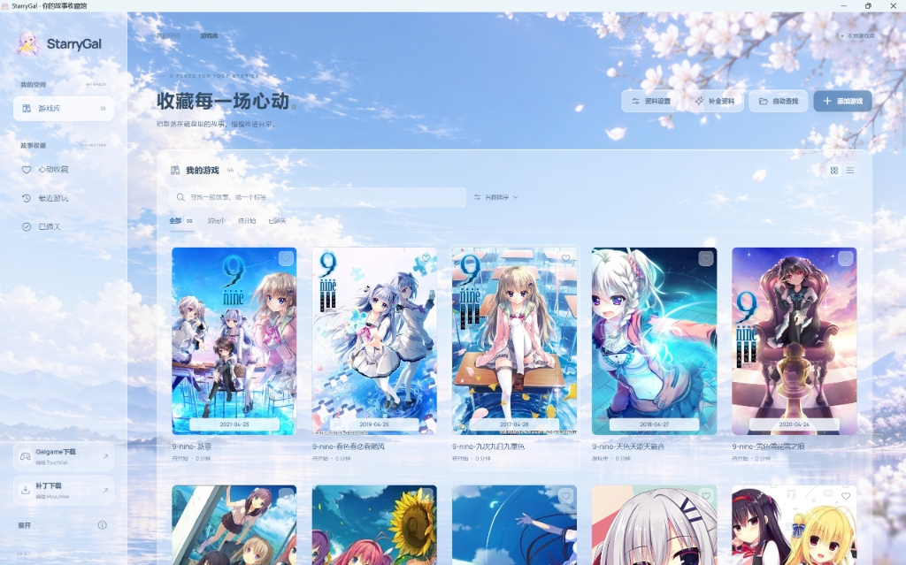

  

<h1 align="center">StarryGal</h1>

把故事，收进日常。

  <a href="https://loveyong07.github.io/loveyong-starrygal/">桌面在线预览</a> ·
  <a href="https://github.com/loveyong07/loveyong-starrygal/releases">下载与更新</a> ·
  <a href="https://loveyong07.top/contact">反馈与联系</a> ·
  <a href="#开发运行">开发运行</a>

  

这是启动器初始效果，左下角可自定义背景

StarryGal 是一款免费开源的 Galgame 启动器，基于 KoiPage，支持本地游戏与 Steam 游戏库管理、游戏启动、TouchGal 资料匹配，以及游戏资源与补丁页面入口。游戏文件的下载在对应网站完成。

界面仅面向桌面使用，最小宽度为 1100px。在线预览保留桌面布局。Windows x64 安装包与便携版通过 [GitHub Releases](https://github.com/loveyong07/loveyong-starrygal/releases/latest) 提供，安装向导可自行选择安装文件夹。

桌面版默认以 1280×720 普通窗口打开。窗口按钮位于界面右上角，可拖动顶部空白区域移动窗口、双击最大化，拖动边缘调整宽高。

应用与安装后显示的名称为 **StarryGal**，源码仓库名为 **loveyong-starrygal**。应用 Logo、桌面图标和网页图标统一采用用户原创图片提取的人物抱星图案。

本项目基于 [morilove37/KoiPage](https://github.com/morilove37/KoiPage) 修改，当前版本为 **0.2.2**，修改日期为 **2026-10-30**。代码采用 **GPL-3.0-only**，完整许可见 [LICENSE](LICENSE)。

## 功能

- **统一游戏库**：开始页与游戏库合并，提供搜索、标签搜索、收藏、最近打开、排序和网格/列表视图；排序与视图在重启后保留。
- **游戏详情**：点击作品进入独立页面，每次从顶部开始，展示封面、游戏名、简介、故事标签、宣传影片和“开始游戏”。
- **游玩状态**：没有打开过的作品为“待开始”；进入详情后为“游玩中”；“已通关”由使用者自行标记，再次打开不会覆盖通关状态。
- **公告**：首次运行或公告内容更新后显示公告，确认后保存已读状态；之后可在左下角“展开 → 公告”重新查看。固定开源免费说明保留，版本更新内容列在其后。
- **自动发现**：桌面版首次确认公告后，自动查找常见游戏目录与 Steam 游戏库，过滤补丁、备份等辅助目录；核对候选后再导入，也可选择文件夹扫描或手动添加 EXE。
- **Steam 识别**：读取本机 Steam 安装路径、libraryfolders.vdf 和已安装 appmanifest。识别出视觉小说引擎的作品默认勾选，其他 Steam 游戏可手动勾选；所有候选都在确认后导入，可先修改名称或取消不需要的条目。
- **TouchGal 资料**：自动补全明确匹配的作品，也可整库补全、搜索并手动确认条目。添加游戏或匹配资料时，可输入至少 3 个字符的部分名称、外文词语或别名，查看候选与资料预览后确认选择；适用于所有作品，无需记住完整标题。展示封面、简介、会社、发售日、只读标签和社区评分，保留自定义封面与手动设置的 PV。
- **截图与 PV / OP**：识别公开简介中的 Markdown 图片和 TouchGal 视频标记。截图紧接游戏介绍并支持放大，官网链接可以点击打开。直接媒体内嵌播放，视频站页面使用浏览器播放，也可手动修改或隐藏影片。
- **启动 EXE**：多个程序时可自行指定实际使用的游戏 EXE，显示当前启动文件名。桌面版会验证文件存在；Steam 条目可切回客户端启动。
- **资源与补丁**：提供当前作品的 TouchGal 资源与补丁页面直达入口，启动器内不加载下载列表。
- **透明玻璃**：可调整不透明度、柔焦、主题色、星光与本地背景。
- **更新与联系**：应用启动后会检查本项目的新版本；也可在左下角“展开 → 检查更新”手动查询。发现新版本后提供 GitHub Releases 下载入口；“反馈与联系”打开 [联系页面](https://loveyong07.top/contact)。

## 公告内容

> 本启动器完全开源免费，请使用时务必将游戏名称填入正确的名称，以便于自动导入

## 使用提示与已知限制

1. 由于 API 调用额度限制，可能无法一次性导入所有游戏资料。可稍后重试，具体恢复时间以接口额度为准，也可配置自己的 Token >_<
2. 默认资料服务通过 Vercel 中转，网络连通性会影响加载速度；如果加载较慢，可以检查网络或稍后重试 >_<
3. 项目仍在持续完善。遇到启动、扫描或资料匹配问题，可以通过下方入口反馈具体情况。
4. 可在“资料设置”中填写自行申请的 Token，申请入口见 [TouchGal 官方 API](https://developer.touchgal.com/docs/api)。
5. 游戏资料以 TouchGal 的收录内容为准，可能缺少字段或没有对应条目。可尝试关键词搜索并手动确认；未收录的作品仍可填写名称与 EXE 添加和启动。
6. [反馈与联系](https://loveyong07.top/contact) (ฅ•.•ฅ)ﻌﻌﻌ♥️

## 使用

1. 从 [最新发行版](https://github.com/loveyong07/loveyong-starrygal/releases/latest) 下载名称以 `windows_x64_setup.exe` 结尾的安装包。首次安装可通过“浏览”选择文件夹；从旧版升级时沿用原安装目录，无需先卸载。也可下载便携版直接运行。打开后阅读公告，进入游戏库。
2. 首次扫描检查各磁盘根目录下常见的 Games、Game、Galgame、Galgames、VisualNovels、游戏、单机游戏目录，以及注册表和 Steam 清单中登记的游戏库。其他目录可以用“扫描文件夹”补充。
3. 在扫描候选列表中核对名称与目录，取消不需要的条目后确认导入。手动添加时，可输入至少 3 个字符的部分名称、外文词语或别名，点击“搜索作品”，查看候选与资料后“确认选择”，再核对本地启动 EXE 并加入游戏库。未收录于 TouchGal 的作品也可以直接填写名称与 EXE 添加。
4. 点击作品进入详情。可编辑正确名称、查看网站标签、收藏，或自行标记为已通关；不提供个人评价模块。
5. 点击“开始游戏”。Steam 作品通过 Steam 客户端启动；本地作品使用既有进程启动与游玩记录逻辑。
6. 点击“补全资料”处理尚未匹配的游戏。自动匹配不明确时，在详情页点击“匹配资料”，核对并确认条目。默认只补全空白字段；需要修正旧资料时，可明确选择替换接口资料。
7. 在详情页观看识别到的宣传影片，也可保存自己的影片链接。通过直达入口在浏览器中查看当前作品的资源与补丁。成人分级作品需要先在资料设置中开启相应选项。
8. 如果扫描选到了错误的 EXE，点击“选择启动 EXE”，浏览并保存正确的程序。

游戏文件保留在原目录。移出游戏库只删除管理记录，不删除游戏本体。浏览器预览记录保存在浏览器本地；桌面版使用独立应用目录中的 SQLite。Steam 启动仅表示请求已交给客户端，本版不把请求成功当作已验证游戏进程或时长。

## TouchGal API

按 [TouchGal 官方 API 文档](https://developer.touchgal.com/docs/api) 接入。默认公开资料接口为 `https://loveyong07.top/api/starrygal`，安装后无需填写开发者密钥；若遇公共调用额度限制，可在“资料设置”中填入自行从 TouchGal API 获取的自定义 Token。桌面版通过 Rust 请求资料服务，网页预览通过无 Cookie 的公开接口请求；资料设置中可以测试连接、自定义 Token 或修改服务地址。

- `src/features/galgame/touchgal.ts`：搜索、详情、字段归一化、严格匹配、取消过期结果与资料合并。
- `src-tauri/src/commands/touchgal.rs`：桌面 HTTP 请求、参数校验、超时与响应大小限制。
- `api/starrygal.js`：服务端中转函数，部署到网站的 Vercel 项目；密钥仅从服务端环境变量 `TOUCHGAL_API_TOKEN` 读取。不得使用 `VITE_` 前缀，不得把真实密钥写进源码或安装包。
- 成功响应使用 CDN 与实例缓存，并合并并发请求；服务端提供每个运行实例内的请求限流。TouchGal 的共享密钥额度由上游统一执行；实例限流不等于全局防滥用，可按实际访问量增加 Vercel 防火墙规则。
- 处理未配置、认证失败、404、429、超时与服务不可用状态。查询失败不影响本地游戏管理；保存后的资料在本机保留，桌面封面沿用现有图片缓存，不支持缓存的图片格式保留原图地址。

接口当前没有独立 PV 字段；部分条目的公开简介包含真实的视频与截图地址，启动器会识别这些标记。不存在对应地址时不编造媒体。资源下载使用 TouchGal 页面入口。默认请求全年龄数据，只有用户显式开启后才传入 `allowNsfw=true`。

## 技术栈

| 层                 | 技术                                                     |
| ------------------ | -------------------------------------------------------- |
| 桌面窗口与本地能力 | Tauri 2、Rust、WebView2                                  |
| 界面               | React 18、TypeScript、Vite、Tailwind CSS、自定义玻璃样式 |
| 本地数据           | SQLite、tauri-plugin-sql                                 |
| 状态与路由         | Zustand、React Router                                    |
| 图标与字体         | Phosphor Icons、Manrope、系统中文字体                    |

## 开发运行

需要 Windows x64、Node.js 24、项目声明版本的 pnpm。运行桌面版还需要 Rust stable、MSVC C++ 构建工具、Windows SDK 与 WebView2。

    git clone https://github.com/loveyong07/loveyong-starrygal.git
    cd loveyong-starrygal
    corepack enable
    pnpm install --frozen-lockfile
    pnpm dev

网页预览默认地址为 `http://127.0.0.1:1420`。建议使用 **1600×900（16:9）桌面画幅**查看界面。

浏览器预览可验证游戏条目、收藏、标签、状态与外观。自动扫描磁盘和运行 `.exe` 需要桌面环境。

运行桌面开发版：

    pnpm tauri dev

检查源码：

    pnpm build
    pnpm build:pages
    pnpm test
    pnpm check:ipc
    pnpm check:release
    cargo test --manifest-path src-tauri/Cargo.toml --lib --bins --locked

安装包发布位置：[GitHub Releases](https://github.com/loveyong07/loveyong-starrygal/releases)。更新按钮打开下载页面；下载新版安装包后直接运行，会沿用注册的原安装目录覆盖升级，无需先卸载。设置、Token、游戏库、封面和游玩记录保存在独立用户数据目录，升级不会清除。便携版将新版 EXE 替换到原位置即可，名称保持原样。

安装版和便携版应分别使用对应文件更新。更新前先正常关闭启动器；游戏本体和个人文件不会被安装器作为旧程序文件删除。已误导入的条目可在游戏详情中“移出游戏库”，新的扫描过滤不会自动删除已有记录。

维护者制作 Windows 安装包：

    pnpm tauri build --bundles nsis --ci

`.github/workflows/release.yml` 在版本变更或手动触发时执行检查、Windows Rust 测试、打包、自定义目录安装与启动验证，以及覆盖升级后的数据保留和旧程序清理验证，然后发布安装包、便携版和 `SHA256SUMS.txt`。安装器模板基于 Tauri CLI 2.12.2，来源与 MIT 许可保存在 `src-tauri/windows/`；升级 CLI 时需同步核对模板。当前不生成自动更新签名文件，也未使用付费代码签名证书。

## 源码结构

- src/features/galgame/：界面、详情、公告、预览数据桥接与资料源适配器。
- src-tauri/src/scanner/discovery.rs：首次发现、Steam 清单解析、候选去重、取消扫描。
- src-tauri/src/scanner/、launcher/、commands/：复用的扫描、启动、记录与 SQLite 能力。
- src-tauri/resources/：运行所需第三方组件及其许可证和对应源代码。
- tests/opengal-*.test.mjs：状态、公告、路径与元数据行为测试。
- .github/workflows/ci.yml：前端构建、测试、IPC 契约与 Windows Rust 测试。

## 致谢

- **[morilove37/KoiPage](https://github.com/morilove37/KoiPage)**：本项目的代码基础，提供 Tauri、SQLite、本地扫描、启动、游玩记录及工具集成。保留原作者署名与 GPL-3.0-only 许可。
- **[KunMoe/kun-touchgal-next](https://github.com/KunMoe/kun-touchgal-next)**：TouchGal 数据结构与接口设计参考。游戏资料由 TouchGal 官方元数据 API 提供，不包含其社区数据库或游戏资源本体。
- [Phosphor Icons](https://github.com/phosphor-icons/react)、[Manrope](https://github.com/sharanda/manrope)、Tauri、React 及其他依赖的维护者。

StarryGal 标志由使用者提供，应用图标采用人物抱星图案，README 展示完整标志。透明素材经 ImageGen 处理，默认背景通过 ImageGen 生成。上游保留的角色素材归各自原权利方所有，代码许可不改变素材权利。游戏封面、简介和影片归各自权利方所有。

## 许可与第三方组件

代码按 GPL-3.0-only 开放，不附带担保。修改与分发时请保留许可证、来源和署名。

Locale Emulator、Magpie、LunaTranslator 和 7-Zip 分别保留各自的 COPYING、LICENSE、NOTICE 与必要的对应源码，位于 src-tauri/resources/。这些是构建和合规分发需要的文件，应与相关代码一起保留。

反馈与联系：[loveyong07.top/contact](https://loveyong07.top/contact)。
